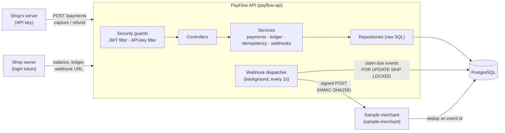
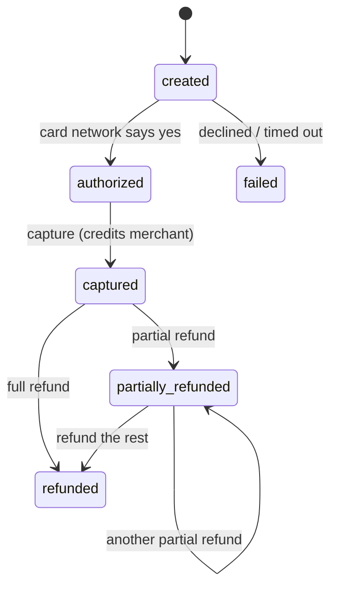

# PayFlow

[](https://github.com/Abhijeet21112004/Payflow/actions/workflows/ci.yml)

A payment gateway backend, the kind of system behind a "Pay Now" button, built to stay **provably correct** under concurrent requests, network retries and partial failures.

**Java 25 · Spring Boot 4 · PostgreSQL 17 · raw SQL (no ORM) · JUnit 5 + Testcontainers · Docker · GitHub Actions**

---

## The headline: a race condition, reproduced and fixed

The first version of capture/refund read the payment, checked its status in Java, then wrote. Under concurrency, that is broken. Real output from `CaptureConcurrencyTest` and `RefundConcurrencyTest` against real PostgreSQL:

| Scenario | Before (`git checkout before-locking`) | After (`main`) |
|---|---|---|
| 50 parallel captures of one ₹500 payment | **10 succeed → merchant credited ₹5,000** | 1 succeeds, 49 get `409` → ₹500 |
| 10 parallel ₹100 refunds of a ₹500 payment | **10 succeed → ₹1,000 refunded**, payment row says ₹100, balance −₹500 | exactly 5 succeed → ₹500, everything agrees |

**The fix** was one line in each operation: read the payment with `SELECT … FOR UPDATE`, which locks that row until the transaction commits, so concurrent requests for the same payment queue up and each sees the previous one's result. Two database constraints back it up, so even buggy code can't corrupt money. Full write-up: [docs/race-condition-results.md](docs/race-condition-results.md).

## What it guarantees, and how each guarantee is proven

| # | Guarantee | Mechanism | Proof (test) |
|---|---|---|---|
| P1 | No double-capture or over-refund under concurrency | `SELECT … FOR UPDATE` on the payment row; `UNIQUE` and `CHECK` constraints as backstops | `CaptureConcurrencyTest`, `RefundConcurrencyTest`, `SafetyConstraintsTest` |
| P2 | Retrying a request never repeats its effect | `Idempotency-Key` reserved via `INSERT … ON CONFLICT DO NOTHING` in the same transaction as the work; the reply is stored and replayed | `IdempotencyTest` (incl. 20 concurrent retries) |
| P3 | All-or-nothing state changes | Payment status, ledger entries, webhook event and idempotency record commit in one transaction | `AtomicityTest` (injects a DB failure mid-capture) |
| P4 | Immutable, balanced audit trail | Double-entry ledger; balances are always summed, never stored; triggers make the ledger append-only | `LedgerTest` |
| P5 | Webhooks are never lost and never double-processed | Transactional outbox + retrying dispatcher (sender); signature check + `ON CONFLICT DO NOTHING` dedup (receiver) | `WebhookDeliveryTest`, `WebhookReceiverTest` |

**49 automated tests** across both apps, all running against real PostgreSQL in CI.

## Architecture



### Payment lifecycle



Any other transition is rejected with `409 invalid_state`.

### What happens during a capture

One database transaction, in this order:

1. **Reserve the `Idempotency-Key`.** If this exact request already completed, return the stored reply and stop.
2. **Lock the payment row** (`SELECT … FOR UPDATE`). A concurrent capture of the same payment waits here.
3. **Check** the status is `authorized`, otherwise reply `409`.
4. **Post to the ledger:** debit `processor_clearing`, credit the merchant's account.
5. **Mark the payment** `captured`.
6. **Write a `payment.captured` event** to the webhook outbox.
7. **Store the reply** under the idempotency key, and commit.

If any step fails, all of it rolls back. After commit, the background dispatcher delivers the webhook.

## Design decisions

| Decision | Why |
|---|---|
| **Lock the payment, not the merchant's account** | The invariant ("captured once", "refunds ≤ amount") belongs to the payment. Locking the account would serialise all of a merchant's payments; locking the shared clearing account would serialise the whole system. |
| **`READ COMMITTED` + explicit `FOR UPDATE`, not `SERIALIZABLE`** | `SERIALIZABLE` would also prevent the race, but by aborting conflicting transactions, so every caller would need retry logic. An explicit lock makes the conflict point visible and turns it into waiting instead of failing. Each operation locks one row, so there is no lock-ordering deadlock. |
| **Double-entry ledger, balances derived** | Every movement has two equal sides, so total debits always equal total credits, which is checkable. Storing a balance column would allow it to drift from history. |
| **Transactional outbox for webhooks** | The event row commits with the payment change; nothing is sent over HTTP inside the transaction. A crash can't lose an event or send one for a change that rolled back. |
| **`POST /payments` uses two transactions** | The card-network call can be slow. Holding a transaction (and its DB connection) open across a network call would starve the pool. |
| **API keys hashed with SHA-256, passwords with BCrypt** | Passwords are guessable, so BCrypt's slowness matters. API keys are 256 random bits; they need a deterministic hash so the merchant can be looked up by it on every request. |
| **Raw SQL via `JdbcTemplate`, no ORM** | Every lock, constraint and transaction boundary is visible in the code. |

## API

| Method & path | Auth | Purpose |
|---|---|---|
| `POST /merchants/register` | none | Create a merchant; returns `api_key` and `webhook_secret` **once** |
| `POST /merchants/login` | none | Email + password → 1-hour JWT |
| `GET /merchants/me` | JWT | Merchant details |
| `PUT /merchants/me/webhook-url` | JWT | Where to send webhooks |
| `GET /merchants/me/balance` | JWT | Balance in paise, summed from the ledger |
| `GET /merchants/me/ledger?limit=&cursor=` | JWT | Ledger history, keyset-paginated |
| `POST /payments` | API key + `Idempotency-Key` | Create a payment; `mock_outcome`: `success` / `decline` / `timeout` |
| `POST /payments/{id}/capture` | API key + `Idempotency-Key` | Capture an authorized payment |
| `POST /payments/{id}/refund` | API key + `Idempotency-Key` | Refund `{amount}` paise, or everything left if omitted |
| `GET /payments/{id}` | API key | Current state |

Amounts are integers in paise (₹1 = 100). Errors always look like `{"error": {"code": "invalid_state", "message": "…"}}`.

Webhooks are POSTed with headers `X-PayFlow-Event-Id`, `X-PayFlow-Timestamp` and `X-PayFlow-Signature: v1=hex(HMAC-SHA256(webhook_secret, timestamp + "." + body))`, and retried after 5s, 30s, 2m, 10m and 1h before giving up.

## Run it

Requires Docker, and Java 25 to run outside containers.

**Everything in containers:**
```bash
docker compose --profile app up -d --build
```
API on http://localhost:8080 (`GET /health`), sample merchant on http://localhost:8081.

**From an IDE:** start the database with `docker compose up -d`, then run `PayflowApiApplication` (and optionally `SampleMerchantApplication`).

**Tests** (each starts its own throwaway PostgreSQL):
```bash
cd payflow-api && ./mvnw verify
cd sample-merchant && ./mvnw verify
```

**Reproduce the race condition:**
```bash
git checkout before-locking
cd payflow-api && ./mvnw test -Dtest='*ConcurrencyTest'
```

## Project layout

```
payflow-api/src/main/java/com/payflow/
├── merchant/      registration, login, webhook URL
├── auth/          JWT and API-key filters
├── ledger/        double-entry ledger, balance, history
├── payment/       payments, card-network simulator, capture, refund
├── idempotency/   key reservation and replay
├── webhook/       outbox, dispatcher, HMAC signing
└── common/        errors, hashing, health check
payflow-api/src/main/resources/db/migration/   V1–V6 schema migrations (Flyway)
sample-merchant/   a minimal shop that receives webhooks exactly once
docs/              spec and race-condition results
```

## Known limitations

- `webhook_secret` is stored in plaintext because HMAC needs the original value. Production would encrypt it at rest (KMS).
- Webhook URLs aren't checked for SSRF; they may point at `localhost` for the demo. Production would block private address ranges.
- If the process crashes between the two transactions of `POST /payments`, that payment stays `created` and its key stays `in_progress`; the client retries with a new key. A sweeper job would clean these up.
- Single currency (INR), full capture only, no settlement to bank accounts, no rate limiting.
